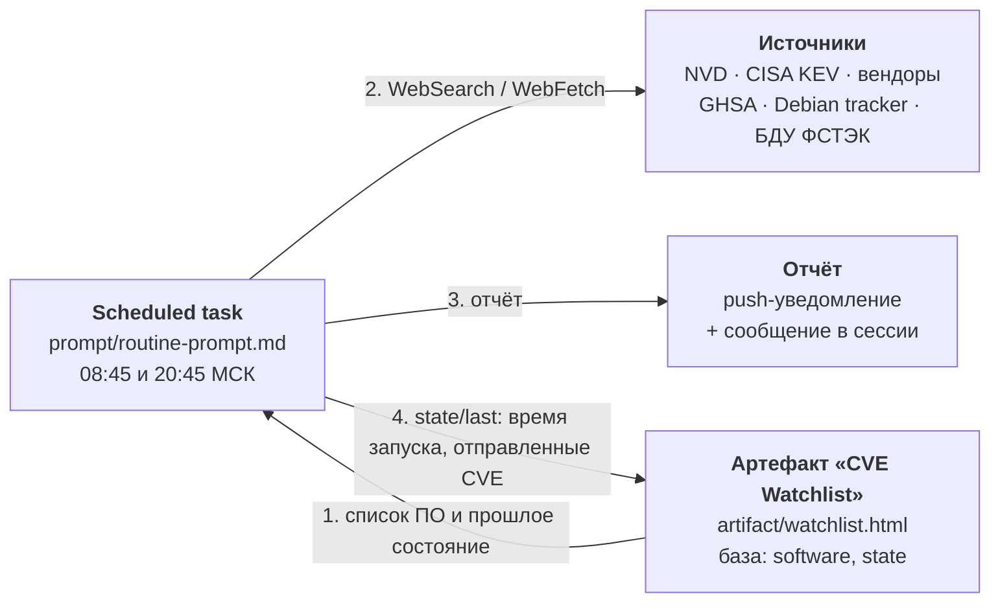

# CVEAgent — мониторинг критичных CVE на Claude

Агент дважды в день (08:45 и 20:45 МСК) ищет новые критичные уязвимости и присылает отчёт на русском языке push-уведомлением в приложение Claude.

Что попадает в отчёт:

- **Общий обзор** — CVE с CVSS ≥ 9.0, новые записи CISA KEV, уязвимости с подтверждённой эксплуатацией или публичным эксплойтом.
- **Ваше ПО** — CVE с CVSS ≥ 7.0 по продуктам из вашего списка, с проверкой, затронута ли ваша версия.
- По каждой CVE: как эксплуатируется (вектор, права, предусловия) и как устранить (версия патча или временные меры с командой проверки).

Повторов нет: агент помнит, какие CVE уже были в отчётах, и снова упоминает их только при существенном обновлении (попадание в KEV, новый эксплойт, вышел патч).

## Как устроено

| Компонент | Файл в репозитории | Где живёт |
|---|---|---|
| Промпт агента | `prompt/routine-prompt.md` | Scheduled task в Claude |
| Промпт для локального запуска и других агентов | `prompt/routine-prompt.local.md` | Данные в `data/*.local.json` |
| Расписание и настройки | `schedule.json` | Scheduled task в Claude |
| Страница со списком ПО | `artifact/watchlist.html` | Артефакт claude.ai с capability `db` |
| Список ПО (снимок) | `data/software.json` | Коллекция `software` артефакта |
| Начальное состояние | `data/state.initial.json` | Документ `state/last` артефакта |
| Пример отчёта | `reports/2026-10-23-morning.md` | — |

### Модель данных артефакта

- `software/<id>` — `name`, `version`, `kind`, `note`, `enabled`, `addedAt`. Записи с `enabled: false` агент пропускает. В `note` пишется контекст для проверки, например «пакет Debian — сверять по Debian Security Tracker».
- `state/last` — `lastRunAt` (ISO-время прошлого запуска, задаёт окно поиска) и `reportedIds` (последние 500 CVE, уже попавших в отчёты).

## Как развернуть у себя

| Где запускать | Инструкция |
|---|---|
| Приложение Claude (Cowork) | ниже в этом разделе |
| Claude Code: облачная задача (`/schedule`) или локальная в Claude Desktop | [docs/claude-code.md](docs/claude-code.md) |
| Hermes Agent, OpenClaw и другие агенты с cron | [docs/other-agents.md](docs/other-agents.md) |

### Приложение Claude (Cowork)

Нужен аккаунт Claude с Cowork, артефактами и scheduled tasks.

1. **Опубликуйте страницу списка ПО.** Попросите Claude: «Опубликуй `artifact/watchlist.html` как артефакт с capability `db`». Сохраните URL артефакта.
2. **Заполните список ПО** — через форму на странице или попросите Claude загрузить `data/software.json` в коллекцию `software` (замените данные на свои).
3. **Создайте scheduled task.** Попросите Claude создать задачу с промптом из `prompt/routine-prompt.md`, подставив URL артефакта вместо `{{ARTIFACT_URL}}`, и расписанием из `schedule.json`. Включите push-уведомления.
4. Первый запуск смотрит последние 24 часа, дальше — от прошлого запуска.

Пример запроса Claude для шагов 1–3:

> Опубликуй artifact/watchlist.html как артефакт с db, загрузи data/software.json в коллекцию software, затем создай scheduled task «Мониторинг CVE» с промптом из prompt/routine-prompt.md (подставь URL артефакта) и расписанием `CRON_TZ=Europe/Moscow 45 8,20 * * *`, с push-уведомлениями.

## Ограничения

- Агент работает в облаке и не видит ваши устройства: версии ПО берутся только из списка, их нужно обновлять вручную после апгрейдов.
- Если источник недоступен (например, cisa.gov), агент отмечает это в отчёте и продолжает по остальным.
- CVSS, версии и патчи, которые не удалось подтвердить, помечаются «н/д». Отчёт — подсказка для приоритизации, а не замена проверки по бюллетеню вендора.

## Безопасность

`data/software.json` и пример отчёта содержат реальную инвентаризацию (модели и версии сетевых устройств). Держите репозиторий приватным или удалите эти файлы перед публикацией. Как сообщать о проблемах безопасности в самом агенте — в [SECURITY.md](SECURITY.md).

## Участие

Правила для изменений промпта, страницы и данных — в [CONTRIBUTING.md](CONTRIBUTING.md).

## Лицензия

[MIT](LICENSE).
